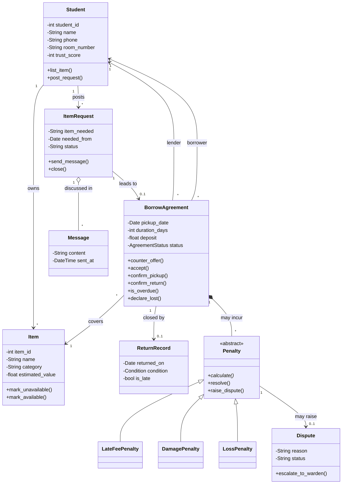

# Hostel Borrowing System: Object-Oriented Programming in Python

A peer-to-peer borrowing system for hostel residents. A student who needs an item contacts a student who owns it, they agree on the terms, and the system tracks the loan, the return, and what happens when the item is late, damaged, or never comes back.

The project doubles as a complete tour of OOP in Python. Every core concept is used for a real purpose in the domain, not in isolation.

- **Code:** [`hostel_borrowing.py`](hostel_borrowing.py) (single file, standard library only, Python 3.10+)
- **Diagram:** `hostel_borrowing_system.drawio` (UML class diagram)

---

## 1. How the system works

1. A **Student** lists an **Item** they own.
2. Another student posts an **ItemRequest** for something they need.
3. The two exchange **Messages** on that request.
4. They agree on the terms, captured in a **BorrowAgreement**: the item, pickup date, duration (and therefore return date), and an optional deposit. Either side can counter-offer before it is accepted.
5. The lender hands over the item (`confirm_pickup`) and the agreement becomes active.
6. When the item comes back, the lender confirms the return and a **ReturnRecord** is created.
7. If the item is **late**, **damaged**, or **lost**, a **Penalty** is created. The borrower can contest it by raising a **Dispute**, which is escalated to the hostel warden.

### Agreement lifecycle

```
Proposed ──accept()──▶ Accepted ──confirm_pickup()──▶ Active ──confirm_return()──▶ Returned
                                                         │
                                                  past return date
                                                         ▼
                                                      Overdue ──confirm_return()──▶ Returned
                                                         │
                                                  declare_lost()
                                                         ▼
                                                      Closed
```

Calling a method in the wrong state (for example, `confirm_pickup()` on a proposed agreement) raises `InvalidTransitionError`.

---

## 2. UML class diagram



In the code, `Penalty` is abstract and has three concrete subclasses. In the first diagram, `Penalty` was a single class that held a `type` field. Turning that into inheritance is what lets the system demonstrate abstraction and polymorphism, and the code also adds `Item.estimated_value`, which loss penalties need. If your diagram has to match the code exactly, add those two changes.

---

## 3. Running it

```bash
python hostel_borrowing.py
```

Expected output:

```
Messages exchanged: 2
Brian borrows 'Charcoal iron box [Appliance]' from Alice, return date 2026-11-13
OVERDUE on 2026-11-15! Status: Overdue
 - LateFeePenalty: UGX 1,500 (Pending)
 - DamagePenalty: UGX 8,000 (Pending)
Total owed: UGX 9,500
Brian's trust score: 65
Dispute status: With warden
```

---

## 4. OOP concepts: where each one appears

| Concept | Where it is used |
|---|---|
| Classes and objects | `Student`, `Item`, `ItemRequest`, `BorrowAgreement`, ... |
| Constructors (`__init__`) | Every class |
| Instance vs class attributes | `Student._ids`, `BorrowAgreement.MAX_DURATION_DAYS` |
| Encapsulation | `Student._trust_score` with a `@property` setter that clamps 0-100 |
| Abstraction | `Penalty(ABC)` with an `@abstractmethod calculate()` |
| Inheritance | `LateFeePenalty`, `DamagePenalty`, `LossPenalty` extend `Penalty` |
| `super()` | Subclass constructors call `Penalty.__init__` |
| Polymorphism | `total_penalties()` calls `calculate()` on mixed penalty types |
| Multiple inheritance / mixins | `BorrowAgreement(TimestampMixin)` |
| Class methods | `Student.from_dict()` |
| Static methods | `BorrowAgreement.is_valid_duration()` |
| Properties | `trust_score`, `return_date`, `is_available`, `items`, `messages` |
| Dunder methods | `__str__`, `__repr__`, `__eq__`, `__hash__`, `__lt__`, `__len__` |
| Association | `Item.owner`, `BorrowAgreement.lender` / `borrower` |
| Aggregation | `ItemRequest` has `Message`s that exist independently |
| Composition | `BorrowAgreement` owns its `Penalty` list and `ReturnRecord` |
| Enums | `AgreementStatus`, `Condition` |
| Dataclasses | `Message` (frozen), `ReturnRecord` |
| Custom exceptions | `HostelError` and its subclasses |
| State management | `_require()` guards every status transition |

---

## 5. Each concept explained with the project's own code

### 5.1 Classes, objects and constructors

A **class** is a blueprint; an **object** is one concrete instance of it. `__init__` runs when an object is created and sets up its state.

```python
alice = Student("Alice", "0700000001", "B12")      # object 1
brian = Student("Brian", "0700000002", "A03")      # object 2
```

Each student has its own `name`, `room_number` and trust score, but both share the same methods.

### 5.2 Instance attributes vs class attributes

Instance attributes belong to one object (`self.name`). Class attributes belong to the class and are shared.

```python
class Student:
    _ids = count(1)                       # shared by ALL students
    def __init__(self, name, phone, room_number):
        self.student_id = next(Student._ids)   # unique per student
        self.name = name

class BorrowAgreement:
    MAX_DURATION_DAYS = 14                # a rule that applies to every agreement
```

### 5.3 Encapsulation

Encapsulation hides internal state and exposes it only through controlled access. Python has no true private members. A leading underscore (`_trust_score`) signals "internal, don't touch directly", and a `@property` provides the public door.

```python
@property
def trust_score(self) -> int:
    return self._trust_score

@trust_score.setter
def trust_score(self, value: int) -> None:
    self._trust_score = max(0, min(100, value))   # always stays within 0..100
```

Because of the setter, `brian.trust_score -= 500` can never produce a negative score. The `items` property returns a `tuple` copy, so outside code cannot modify a student's private item list.

### 5.4 Abstraction

Abstraction defines *what* an object must do without saying *how*. `Penalty` is an abstract base class: it cannot be instantiated, and every subclass must implement `calculate()`.

```python
class Penalty(ABC):
    @abstractmethod
    def calculate(self) -> float:
        """Return the amount owed in UGX."""
```

`Penalty(agreement)` raises `TypeError`. Only concrete penalties can be created.

### 5.5 Inheritance and `super()`

A subclass reuses and extends its parent. Each penalty inherits `resolve()`, `raise_dispute()` and `__str__` for free, and adds only what is unique to it.

```python
class LateFeePenalty(Penalty):
    def __init__(self, agreement, days_late, daily_rate=500):
        super().__init__(agreement)       # parent sets id, agreement, status
        self.days_late = days_late
        self.daily_rate = daily_rate
```

### 5.6 Polymorphism

Polymorphism means the same method call behaves differently depending on the object. The agreement never checks which kind of penalty it holds:

```python
def total_penalties(self) -> float:
    return sum(p.calculate() for p in self.penalties)
```

| Class | What `calculate()` returns |
|---|---|
| `LateFeePenalty` | `days_late * daily_rate` |
| `DamagePenalty` | the repair cost |
| `LossPenalty` | item value minus the deposit already held |

A new penalty type (say, `CleaningFeePenalty`) can be added without changing `BorrowAgreement` at all.

### 5.7 Multiple inheritance and mixins

A mixin is a small class that adds one capability to others. `BorrowAgreement` gets a `created_at` timestamp this way.

```python
class TimestampMixin:
    def __init__(self, *args, **kwargs):
        super().__init__(*args, **kwargs)
        self.created_at = datetime.now()

class BorrowAgreement(TimestampMixin):
    def __init__(self, ...):
        super().__init__()                # runs the mixin's __init__
```

Python resolves the order of parent classes using the **MRO** (method resolution order). Inspect it with `BorrowAgreement.__mro__`.

### 5.8 Class methods and static methods

| Kind | First parameter | Use it when |
|---|---|---|
| Instance method | `self` | it works with one object's data |
| `@classmethod` | `cls` | it works with the class, e.g. an alternative constructor |
| `@staticmethod` | none | it is a utility that belongs with the class but needs no object |

```python
@classmethod
def from_dict(cls, data: dict) -> Student:       # alternative constructor
    return cls(data["name"], data["phone"], data["room_number"])

@staticmethod
def is_valid_duration(days: int) -> bool:         # pure rule check
    return 1 <= days <= BorrowAgreement.MAX_DURATION_DAYS
```

### 5.9 Properties for computed values

`return_date` is never stored; it is calculated from the pickup date and duration, so it can never go out of sync after a counter-offer.

```python
@property
def return_date(self) -> date:
    return self.pickup_date + timedelta(days=self.duration_days)
```

### 5.10 Dunder (special) methods and operator overloading

Dunder methods let your objects work with Python's built-in syntax.

| Method | Enables | Example in this project |
|---|---|---|
| `__str__` | `print(obj)` | `print(alice)` gives `Alice (room B12)` |
| `__repr__` | debugging output | `Student(id=1, name='Alice')` |
| `__eq__` / `__hash__` | `==`, sets, dict keys | two students are equal if their IDs match |
| `__lt__` | `<`, `sorted()` | `sorted(students)` ranks by trust score |
| `__len__` | `len(obj)` | `len(request)` returns the number of messages |

### 5.11 Relationships between objects

| Relationship | Meaning | In this project |
|---|---|---|
| Association | one object uses or knows another | `Item.owner`, `BorrowAgreement.borrower` |
| Aggregation | "has-a", parts can exist alone | `ItemRequest` has `Message`s |
| Composition | "owns-a", parts die with the whole | `BorrowAgreement` owns its penalties and return record |
| Inheritance | "is-a" | `LateFeePenalty` is a `Penalty` |

### 5.12 Enums

Enums replace error-prone strings with a fixed set of named values.

```python
class AgreementStatus(Enum):
    PROPOSED = "Proposed"
    ACCEPTED = "Accepted"
    ACTIVE = "Active"
    OVERDUE = "Overdue"
    RETURNED = "Returned"
    CLOSED = "Closed"
```

A typo like `AgreementStatus.ACTVE` fails immediately, whereas the string `"actve"` would silently pass.

### 5.13 Dataclasses

For classes that mostly just hold data, `@dataclass` generates `__init__`, `__repr__` and `__eq__` automatically. `frozen=True` makes the object immutable, which suits a chat message that must never be edited after sending.

```python
@dataclass(frozen=True)
class Message:
    sender: Student
    content: str
    sent_at: datetime = field(default_factory=datetime.now)
```

### 5.14 Custom exceptions

Domain-specific errors make failures easy to catch and understand.

```python
class HostelError(Exception): ...
class ItemUnavailableError(HostelError): ...
class InvalidTermsError(HostelError): ...
class InvalidTransitionError(HostelError): ...

try:
    agreement.confirm_pickup()
except HostelError as err:           # catches any error from this system
    print(err)
```

### 5.15 Enforcing a state machine

`_require()` is the single guard that protects the lifecycle, so a loan cannot be returned before it is picked up, or accepted twice.

```python
def _require(self, *allowed: AgreementStatus) -> None:
    if self.status not in allowed:
        raise InvalidTransitionError(
            f"Not allowed while agreement is {self.status.value}")
```

---

## 6. When the item is not returned: the penalty rules

| Situation | Method | Result |
|---|---|---|
| Past the return date, still out | `flag_overdue(today)` | status becomes `Overdue` |
| Returned late | `confirm_return(...)` | `LateFeePenalty` (UGX 500 per day) and trust score drops by 5 per day |
| Returned damaged | `confirm_return(..., Condition.DAMAGED, repair_cost=...)` | `DamagePenalty` and trust score drops by 20 |
| Never returned | `declare_lost()` | `LossPenalty` (item value minus deposit), trust score drops by 40, agreement `Closed` |
| Borrower contests | `penalty.raise_dispute(reason)` | `Dispute`, then `escalate_to_warden()` |

The rates (UGX 500 a day, the trust deductions, the 14-day limit) are placeholders. Change them to suit your hostel's rules.

---

## 7. Design principles on show

- **Single responsibility:** each class has one job (`Item` tracks availability, `Penalty` calculates money, `BorrowAgreement` manages the lifecycle).
- **Open/closed:** new penalty types extend the system without editing existing code.
- **Encapsulation of invariants:** trust score limits and status transitions are enforced inside the classes, not left to callers.
- **Fail loudly:** invalid actions raise specific exceptions instead of silently doing nothing.

---

## 8. Ideas for extending the project

- Persist data with SQLite or JSON using `__dict__` / `dataclasses.asdict`.
- Add a `Notification` class with an abstract `send()` and `SMSNotification` / `EmailNotification` subclasses.
- Add a `__iter__` method on `Student` so you can loop over their items directly.
- Write unit tests with `unittest` or `pytest`, for example that `LossPenalty` never goes negative.
- Use `typing.Protocol` to define a `Payable` interface that penalties and deposits both satisfy.